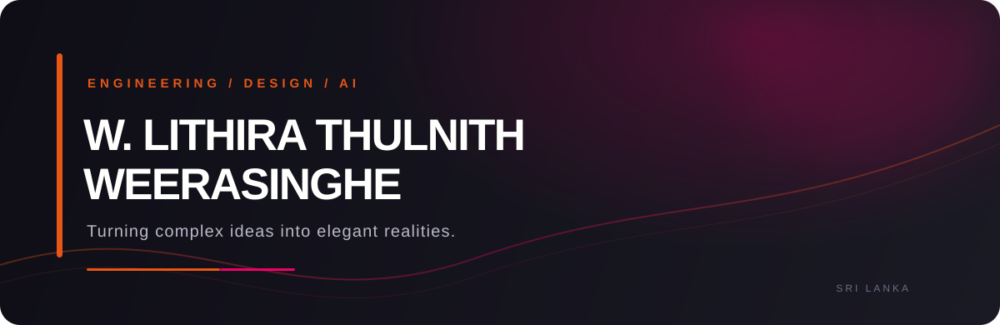

 

**FULL-STACK DEVELOPER · STUDENT · CONTENT CREATOR**

---

## 

I turn complex ideas into useful digital experiences. My work brings together **web engineering, applied AI, automation, and visual communication** — from interactive learning tools to creative production workflows.

I enjoy taking an idea from its first concept to a working experience: understanding the problem, shaping the interface, building the system, and refining the details that make it usable.

- **Based in:** Sri Lanka
- **Focus:** Full-stack web development, AI-assisted workflows, UI/UX, and creative production
- **Portfolio:** [wltweerasinghe.com](https://wltweerasinghe.com)

---

## 

<table>
<tr>
<td width="50%" valign="top">

### 01 — Legendary Volume Game by LTW v3.0

**Interactive mathematics learning web application**

Browser-based educational game designed for students to practice 3D volume calculations and geometric concepts through interactive challenges.

</td>
<td width="50%" valign="top">

### 02 — Secure Code Generator

**Zero-trust client-side security utility**

Client-side web application engineered to generate cryptographically secure random authentication tokens, high-entropy passwords, and cryptographic keys.

</td>
</tr>
<tr>
<td width="50%" valign="top">

### 03 — PotterVerse by LTW

**Telegram bot live interaction system**

Interactive simulation bot environment built for live user engagement and structured workflows.

</td>
<td width="50%" valign="top">

### 04 — LTW Smart Board OS

**Smart display operating system simulation**

Interactive front-end web simulation modeling a smart interactive display operating environment.

</td>
</tr>
</table>

### Recognition

**Commended by President's College, Kotte** for creativity and technical execution.

> “Your creativity truly inspires us.”
>
> — Media Unit, President's College, Kotte

---

## 

<table>
<tr>
<td width="50%" valign="top">

### Event & Ceremony Coverage

- **Suwisi Pattana Pujawa** — Produced by LTW (October 2026)
- **Katina Dhamma Sermon** — Produced by LTW (November 2025)
- **Sacred Yashodara Statue Offering Ceremony** — Visual coverage and production (April 2023)

</td>
<td width="50%" valign="top">

### Creative & Promotional Media

- **Curtain Raiser — Evrim 2025 (ELA)** — Event teaser and promotional video production
- **Ulakudaya Deviyata Puthek Labilalu Anna** — Creative audio-visual remix by W. Lithira Thulnith Weerasinghe

</td>
</tr>
</table>

---

## 

<table>
<tr>
<td align="center" width="33%">
<strong>OVERALL WINNER</strong> 
Arrowow AI Video Workshop & Competition · October 2026
</td>
<td align="center" width="33%">
<strong>92%</strong> 
Analytical Aptitude Assessment · February 2026
</td>
<td align="center" width="33%">
<strong>FIRST PLACE</strong> 
Best Presenter's Competition · Sri Jayawardenapura Zone
</td>
</tr>
</table>

### Selected credentials & learning

- **Arrowow AI Video Workshop and Competition** — Overall Winner (First Place), October 2026. Produced an original short film using AI-assisted image/video generation, scriptwriting, prompt design, editing, and sound. [Verify credential](https://credsverse.com/credentials/cb4b6885-e2d5-446f-9419-1e48bae1e912?preview=1)
- **Jumpstart AI (15-Hour AI Literacy Program)** — HCL Technologies in collaboration with Pathfinder EdTech, April 2026.
- **Analytical Aptitude Assessment** — 92%, AOG Campus, February 2026.
- **Generative AI Mastermind (2-Day Workshop)** — GrowthSchool, January 2026.
- **Creative Design** — Southern Iraa Institute, October 2025.
- **Best Presenter's Competition (Senior Team)** — First Place, Sri Jayawardenapura Education Zone, October 2024.
- **Step Into Innovate Through Robotics** — Southern Iraa Institute, April 2025.
- **First Aid** — St John Ambulance, August 2023.
- **Automotive Scanning & Diagnosis** — OBD Academy, July 2023.

---

## 

### Web engineering

### AI & automation

### Design & media

---

## 

- **Digital product development** — planning and building web experiences around real user needs.
- **AI adoption & automation** — identifying practical opportunities to integrate AI into existing workflows.
- **Development training** — hands-on guidance in modern full-stack web development.
- **Creative technology** — combining design, video, and AI tools to communicate ideas effectively.

---

## 

  

Copyright &copy; 2023-2026 W L T Weerasinghe. All rights reserved.

---